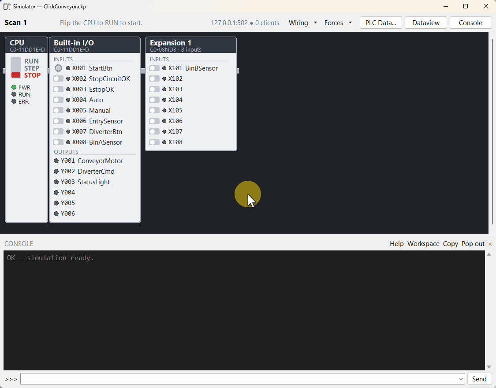
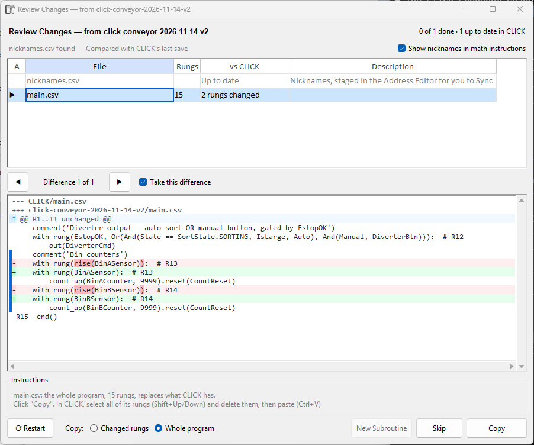

# Does Click Have a Simulator? Now It Does

CLICK Programming Software has no simulator. AutomationDirect's Productivity and Do-more software do, but if you program Click PLCs, you find out what your logic does when you write it to a PLC.

[ClickNick](https://pyrung.com/clicknick/) adds one. It's a free, open-source Windows tool that sits beside the Click software and runs your saved program with no PLC attached. It's my own project: not official, and not affiliated with or endorsed by AutomationDirect.



## Run it, then ask why

Simulate draws your hardware from System Configuration, with switches and LEDs. Press RUN and work the panel the way you'd work the machine. You can step scan by scan, force points, and connect a Data View or HMI over Modbus at `127.0.0.1:502`, as you would to the real PLC.

Then there's the Console. In the gif, Start does nothing, which on a real machine means opening the rungs and tracing contacts by hand. Here I ask:

- `why ConveyorMotor` says what is holding it off.
- `how ConveyorMotor` says what has to happen to turn it on.

You can also right-click an output and see its logic simplified down to one expression, across every rung that reaches it.

If your logic waits on feedback, like a motor contactor proving it pulled in, you can link that input to its output with a delay. The Simulator closes the loop for you, so a feedback fault timer doesn't trip just because nobody's there to flip a switch in 5 ms.

## How it came together

Click V4 is what started this. As we dug in, we figured out we could read the module names from the project, and I slowly started to think: hey, we've got all the pieces here. [pyrung](https://pyrung.com/pyrung/) already ran the ladder, and ClickNick already read it from the project. All that was missing was something you could look at and click on.

I got the GUI working, but a simulator is only as good as its engine. So this was the time to get the semantics nailed down.

## Trust the simulation

In [Gradual Typing for Ladder Logic](gradual-typing-for-ladder-logic.md#trust-the-simulation), I said a Modbus verification harness was in progress. It's done.

Each conformance case is a plain-English sentence, a small ladder that works out its own answer and writes it to a register, and a check that reads that register over Modbus. The harness sees only registers, so the same case runs unchanged on pyrung and on a real Click. The expected answer is always what the Click does.

Thankfully, AI has turned into a conformance beast. It asked the hundreds of questions I'd never have had time to ask. Getting them onto a Click was my monotonous part to do.

The suite is too big for one Click project (8,000 steps), so it's 23 projects. For each one, I set up the project, step through Review Changes, run Syntax Check, and flag whatever didn't paste right or Click doesn't like. Some instructions looked dead on the PLC until I looked closer. Click had accepted a paste its own instruction dialog would refuse, like an empty `""` in a text Copy, where the dialog wants `$00`. Some of it I could repair just by opening the instruction and clicking OK. A Math formula I had to retype, because Click wants its own spacing: `ABS ( x )`, not `ABS( x )`.

Doing that 23 times is how Review Changes got faster. It now marks which programs differ from Click's last save and steps through only those. It does the subroutines before `main`, so the Calls have something to call, and it opens Click's New Subroutine window with the name filled in.



*The change in the picture: `rise()` comes off two counter rungs. A Click counter already counts rises, which I learned the hard way. More on that below.*

Every paste failure got fixed in laddercodec, the library that writes the paste, so the next paste comes out right. Its last few releases are mostly that: formulas written the way Click's editor writes them, a drum that Click v4 rejected with C000A when Jump was off, pastes over 256 rungs, and a termination code written `$D` where Click writes `$0D`.

The first round on hardware turned up 14 behaviors pyrung had wrong. Three of them are worth telling.

### Counters count rises

This one's embarrassing, because I build machines on these PLCs. I had originally coded counters to count on every scan their Enable was on. A Click counts when the input *rises*. Hold the input for five scans and a Click counts 1. pyrung counted 5. That's fixed now.

### Rungs don't solve the way you were taught

This one is subtler, and getting it right is the most faithful thing we did. Everyone learns "left to right, top to bottom." That's almost true, but not for branches.

```text
   C1
───┤/├───┬─── SET C1
         ├─── SET C2
         │     C2
         ├────┤/├─── OUT Y001
         │     C2
         └────┤ ├─── OUT Y002
```

C1 and C2 are both off going in. On a real Click, on this scan:

- **The rest of the rung still has power.** `SET C1` turned on the bit its own trunk contact reads, but the trunk was read once, and that answer is held for everything below it.
- **Y001 stays off and Y002 comes on.** Each branch reads its contacts when the solve reaches it, so both see the C2 that was set just above them.

pyrung used to read every contact when it entered the rung, so it turned on Y001 instead. Now each row reads what a Click reads, at the moment a Click reads it.

### A Math error doesn't stop the PLC

The Click help says a Math error, like the square root of a negative number, turns on SC50 and puts the PLC in STOP. pyrung followed the help, so pyrung stopped too.

Our C2-03CPU did neither. It wrote 0 to the destination, turned on SC46 for the rest of the scan, and stayed in RUN. I don't know of a Click setting that changes this, so the docs and pyrung were both wrong, at least on this PLC.

### The report

The current count, what the cases cover, and the few places pyrung still knowingly differs are on pyrung's [conformance page](https://pyrung.com/pyrung/guides/conformance/), along with how to run the suite against your own Click.

Hardware: CLICK V4.00, C2-03CPU. A run on the PLC is what marks a case confirmed, and rewriting a case drops it back to unconfirmed until it passes again.

## What it doesn't do

- **Interrupts, PID, and high-speed instructions are not yet supported.**
- It simulates your program, not your machine. Linked feedback is a delay you typed in, not a motor.
- It doesn't run at your PLC's scan time. It runs on your PC.
- The conformance results come from one CPU. Yours may differ in ways the suite doesn't reach.

The simulator doesn't replace testing. Test on the real machine, with proper safeguards, before anything interacts with people.

## Try it

```powershell
uv tool install clicknick
clicknick
```

Open your project in the Click software, save it, and click Simulate. [Install instructions](https://pyrung.com/clicknick/install/) and [a tour of the Simulator](https://pyrung.com/clicknick/tour/simulator/) are on the ClickNick site. Change the ladder, save it in Click again, and ClickNick rebuilds what it runs.
